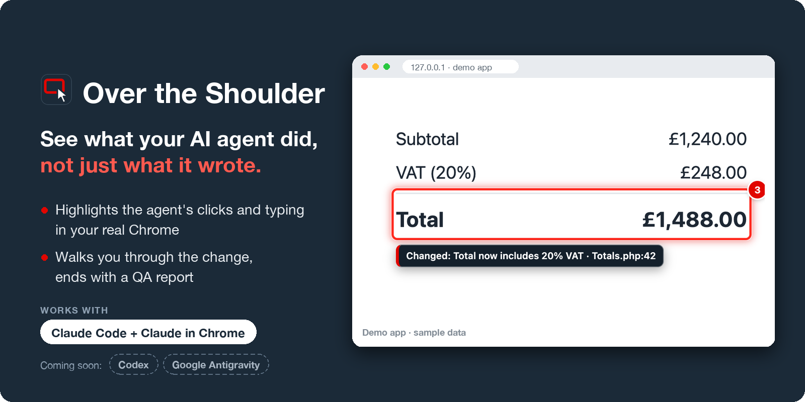

# Over the Shoulder

**See what your AI agent did, not just what it wrote.**

AI coding agents write code fast. Seeing what the change actually does in the running app is the slow
part. Over the Shoulder lets your agent show you, in your own Chrome, one visible step at a time:

- a **Chrome extension** that shows where the agent's clicks and typing land (an outline and a ripple;
  hovers too, best effort), with step numbers, finding labels and optional spoken narration;
- a **skill** that tells the agent to walk you through its change in the real app, tie each visible
  difference back to the code (`file:line`), and finish with a QA report.

It does not drive the browser itself. It sits on top of whatever your agent already uses.



*Screenshot from a demo invoice app, with sample data: the extension outlines the changed total, numbers the
step and labels what changed and where in the code.*

> Status: 0.2.1, works with **Claude Code + Claude in Chrome**. Codex and Google Antigravity are coming soon.

## Install

### 1. The extension

1. Download `over-the-shoulder-<version>.zip` from the
   [latest release](https://github.com/ahmadrazainbox/over-the-shoulder/releases/latest) and unzip it
   (or clone this repository and use its `extension` folder).
2. Open `chrome://extensions`, turn on **Developer mode**, click **Load unpacked** and choose the
   unzipped folder.
3. Pin **Over the Shoulder** to the toolbar.

It needs Chrome 128 or later. After you update or reload the extension, the old overlay removes itself;
if an open tab then shows none, reload that tab.

It runs on `localhost`, `127.0.0.1` and `*.test` out of the box. For any other site, open that site, click
the toolbar icon and press **Enable on this site**.

### 2. The skill (Claude Code)

```
/plugin marketplace add ahmadrazainbox/over-the-shoulder
/plugin install over-the-shoulder@over-the-shoulder
```

Then, after a change: *"Show me the change in the browser."*

## What you see

| Agent action | On the page |
|---|---|
| Hover | The page dims for a moment and the target glows; a soft outline stays |
| Click | A ripple and an outline |
| Typing | An outline on the field |
| Step event | A numbered badge on the target (or a toast in the corner) |
| Finding | A label beside the target |

Your own mouse and typing are left alone: an agent's hover is a single jump, while a hand sends a stream
of small moves, and typing is shown only after the agent's own hover or click. Turn on **Also show my own
clicks** in the popup if you want yours too. Telling the two apart is a best guess, not a guarantee: a
short agent hop can go unlit, and an unusual hand movement can occasionally light something. Keys carry
no position, so if you type into a field the agent has just clicked, without touching the mouse first,
your typing is drawn as the agent's.

## Voice

Off by default. In the popup: **Speak each step**, pick a voice and speed, and whether a new step
interrupts the last one. **Alt+Shift+S** (while Chrome is focused), or switching voice off, stops speaking
and keeps it quiet for ten seconds. Only the tab in front can speak.
Offline system voices keep everything on your computer; voices marked **online** send the spoken text to
Google.

## For agents: the step event

```js
window.dispatchEvent(new CustomEvent('over-the-shoulder', {
  detail: JSON.stringify({ step: 4, label: 'Total shows 0.00', say: 'Now I save. Watch the total.' })
}))
```

`detail` must be a JSON string. All fields are optional: `step` (badge), `label` (finding, up to 200
characters), `say` (spoken if voice is on, up to 300 characters), `selector` (the step's own target, a CSS
selector in the top page; not found sends the step to the corner toast), `at` (`{ x, y }` in the page's CSS
pixels, instead of `selector`) and `log` (`true` writes the page's log of what was drawn).

The overlay answers on its host element, `document.querySelector('[data-over-the-shoulder]')`:
`dataset.last` is what the latest step drew (`on`: the element, or `toast`), `dataset.log` the log as JSON
(after `log: true`), `dataset.version` the extension's version. The skill reads these to check its report.

Any script on a page where the overlay runs can send this event, not only your agent, and could also draw
look-alike marks of its own. So treat the overlay as a guide to follow the agent, not as proof of what it
did; the agent's chat and its final report are the record. Enable the extension only on sites you trust.

## Privacy

Draws only. It never reads field values or keys, stores nothing but your settings, and sends nothing
anywhere. While a page is open it keeps a short list of what it drew there (element role and label or
visible text, never what was typed), so the agent can check its report. See [PRIVACY.md](PRIVACY.md).

## Develop

```
npm install
npx playwright install chromium
npm test
```

The tests load the extension into Playwright's Chromium and check the overlay (hovers, clicks, typing,
shadow DOM, iframes, single-page navigation, the step event, voice), the popup (site detection, enabling a
site, voice settings) and site registration (enabled sites get the overlay, removed ones lose it). They
also replay real Claude in Chrome sessions, recorded with the developer's own mouse still and moving, through
Chrome's input layer ([test/traces](test/traces/README.md)).

## Releases

Versions follow [semantic versioning](https://semver.org): 0.1 Claude, 0.2 stable on Claude, 0.3 adds
Codex, 0.4 adds Google Antigravity, 1.0 is the first Chrome Web Store release. Each release is a
`v<version>` tag with the extension zip attached; see [CHANGELOG.md](CHANGELOG.md).

## Author

Built by **Ahmad Raza**: [armunir.com](https://armunir.com)

## Licence

MIT
